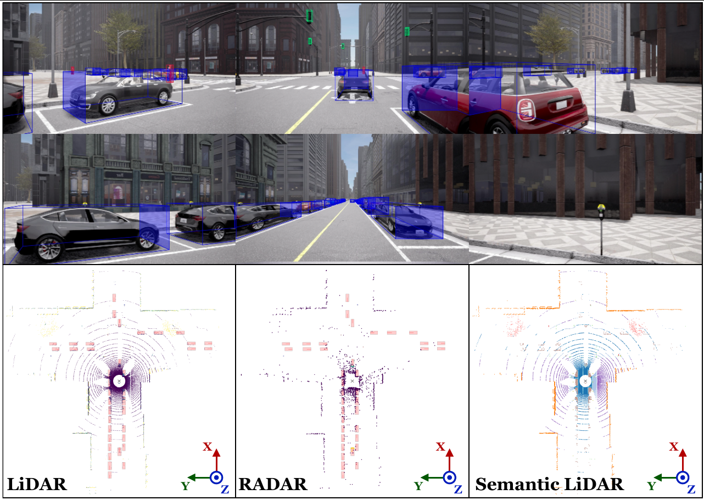
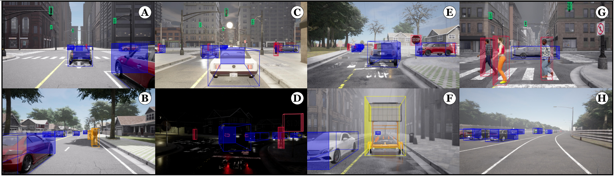

# 🚘 *CARLADrive* 🚘

This repository contains the code for generating and formatting the CARLADrive dataset from the paper **CARLADrive: A Synthetic Multimodal Perception Dataset for Autonomous Driving**, accepted at ITSC 2026 (paper link coming soon).




---

## 📥 Download

[](https://doi.org/10.21950/CMWU2T)

The full standard version of the **CARLADrive Dataset** (30 training + 5 validation routes, ~296 GB compressed) is publicly available at **e-cienciaDatos** (Consorcio Madroño):

👉 [**Download CARLADrive Dataset**](https://edatos.consorciomadrono.es/dataset.xhtml?persistentId=doi:10.21950/CMWU2T)

The dataset is distributed as one `.zip` file per route, named `route_routeX_routes_{training,validation}_date_<MM_DD_HH_MM_SS>.zip`, so you can download individual routes from the web interface or all of them from the command line via the Dataverse API:

```bash
DOI="doi:10.21950/CMWU2T"
SERVER="https://edatos.consorciomadrono.es"

curl -s "$SERVER/api/datasets/:persistentId/?persistentId=$DOI" \
  | jq -r '.data.latestVersion.files[] | "\(.dataFile.id) \(.dataFile.filename)"' \
  | while read -r id name; do
      wget -c -O "$name" "$SERVER/api/access/datafile/$id"
    done
```

A single route can also be fetched directly by its file id, e.g.:

```bash
wget -c -O route_route0_routes_training.zip https://edatos.consorciomadrono.es/api/access/datafile/45729
```

Each zip extracts to a single `route_routeX_routes_{training,validation}_date_<...>/` folder that is **already formatted**: it contains both the raw simulator outputs and the KITTI-like files (`labels/`, `calib/`, `points/`, `radar_points/`, `invalid_files.txt`) described in the Usage section below. There is no need to run the data generation or `format_dataset.py` to use the released dataset; the split (training/validation) is encoded in each folder name.

---

## 🚀 Getting Started

### CARLA Installation

To install CARLA Leaderboard 2.0 version, simply run:

```bash
cd pdm_lite
chmod +x setup_carla.sh
./setup_carla.sh
```

More details in [pdm_lite/README.md](pdm_lite/README.md).

### Docker Setup

Build the Docker image:

```bash
make build
```

Additionally, you can configure the following parameters of the image in the Makefile:

- `IMAGE_NAME`: Name of the generated Docker image.
- `TAG_NAME`: Tag of the generated Docker image.
- `USER_NAME`: Name of the user inside the Docker container.

Then, change PATH_TO_CARLADRIVE in the Makefile, according to your desired dataset path:

```
PATH_TO_CARLADRIVE := path/to/carladrive
```

Run the container:

```bash
make run
```

To open an additional shell in the running container:

```bash
make attach
```

---

## ⚙️ Usage

🔧 **Environment Variables**

The `entrypoint.sh` sets CARLA-related variables. If you changed `USER_NAME` in the Makefile, update `CARLA_ROOT` and `WORK_DIR` in `.env`.

🧭 **Routes**

Set the desired route file in `pdm_lite/start_expert_local_base.sh`. The default set is located in `pdm_lite/leaderboard/data/`:

```bash
export ROUTES=/home/carladrive/workspace/pdm_lite/leaderboard/data/routes_training.xml
```

Additionally, change the save path for the data generated and the logs within the same file:

```bash
export PTH_LOG="/home/carladrive/Datasets/CARLADrive/CARLADrive_routes/routes_training"
export SAVE_PATH="/home/carladrive/Datasets/CARLADrive/CARLADrive_routes/routes_training"
```

📷 **Sensor Suite**

Modify the sensor suite or simulation parameters in `pdm_lite/team_code/config_nusc.py` (adapted from nuScenes).

🗂 **Data Generation**

Enable data saving by setting:

```bash
DATAGEN=1
```

in [pdm_lite/start_expert_local_base.sh](pdm_lite/start_expert_local_base.sh) (it is by default). Otherwise, the simulation would run but no data would be stored.

Then, launch CARLA in the host in a separate terminal:

```bash
cd pdm_lite/carla/CARLA_Leaderboard_20
./CarlaUE4.sh -carla-streaming-port=0 -carla-rpc-port=2000
```

Run the expert in the container, from the repository root (no need to `cd` into `pdm_lite`):

```bash
./pdm_lite/start_expert_local_base.sh
```

This generates one folder per route in `SAVE_PATH`. Since the Makefile mounts `PATH_TO_CARLADRIVE` (host) at `/home/carladrive/Datasets/CARLADrive` (container), the data ends up under `PATH_TO_CARLADRIVE` on the host, with the following structure:

```bash
  route_routeX/
  └──── bev_semantics/
  |      ├──── 0000.png
  |      └──── ...
  └──── boxes/
  |      ├──── 0000.json.gz
  |      └──── ...
  └──── measurements/
  |      ├──── 0000.json.gz
  |      └──── ...
  └──── CAM_BACK/
  |      ├──── 0000.jpg
  |      └──── ...
  └──── CAM_BACK_LEFT/
  └──── CAM_BACK_RIGHT/
  └──── CAM_FRONT/
  └──── CAM_FRONT_LEFT/
  └──── CAM_FRONT_RIGHT/
  └──── CAM_FRONT_INST/
  └──── lidar/
  |      ├──── 0000.laz
  |      └──── ...
  └──── lidar_semantic/
  └──── RADAR_BACK_LEFT/
  |      ├──── 0000.bin
  |      └──── ...
  └──── RADAR_BACK_RIGHT/
  └──── RADAR_FRONT/
  └──── RADAR_FRONT_LEFT/
  └──── RADAR_FRONT_RIGHT/
  └──── records.json.gz
  └──── results.json.gz

  route_routeX+1/
  └──── ...
```

🗂 **Data Formatting**

Format the dataset into a KITTI-like structure (≈1 minute per 3,000 samples).

```bash
python format_dataset.py -p /path/to/dataset
```

`/path/to/dataset` supports two layouts:
- **Split**: the dataset path contains `routes_training`/`routes_validation` subfolders (each holding `route_*` folders), matching two separate data-generation runs — one per routes file. This is the standard layout for a full release.
- **Flat**: the dataset path directly contains `route_*` folders with no split, useful for quickly formatting a one-off or test run (e.g. against `routes_devtest.xml`) without needing to separate training/validation.

New folders and files per route:

```bash
  route_routeX/
  └──── labels/
  |      ├──── 0000.txt
  |      └──── ...
  └──── calib/
  |      ├──── 0000.txt
  |      └──── ...
  └──── points/         # For LiDAR point clouds.
  |      ├──── 0000.bin
  |      └──── ...
  └──── radar_points/   # For aggregated RADAR point clouds.
  |      ├──── 0000.bin
  |      └──── ...
  └──── invalid_files.txt
```

- **`points/`**: LiDAR point clouds in `.bin` format.  
- **`radar_points/`**: radar point clouds in `.bin` format, obtained by grouping the 5 radars of the sensor suite with compensated velocities.  

This script also filters samples where the agent collides or is hit by another agent and includes those samples in each route's `invalid_files.txt` file. It also registers the number of instances per class across the whole dataset in a single `class_instances.txt` file, written at the dataset root (i.e. `/path/to/dataset/class_instances.txt`, not per-route).

**Optional: 2D Bboxes**

Optionally, you can add 2D bboxes to the instances that appear in CAM_FRONT (this takes considerably more time and CAM_FRONT_INST is needed):

```bash
python extend_2d_bboxes.py -p /path/to/dataset
```

📑 **Annotations**

Each line in `labels/XXXX.txt` is one object instance. Most classes share a common layout, with two exceptions (`traffic_light` and `weather`) described below.

Standard object instances (`car`, `walker`, `bicycle`, `stop_sign`, `static_trafficwarning`) are stored as:

```bash
<class> <width> <height> <length> <x> <y> <z> <yaw> <num_lidar_points> [<speed_x> <speed_y>]
```

- **Dimensions**: width, height, length.
- **Position**: (x, y, z) in ego frame (z = ground-relative).
- **Yaw**: rotation around Z axis.
- **Num_lidar_points**: LiDAR hits on the object.
- **Speed (x, y)**: only present for `car`, `bicycle`, and `walker`. `stop_sign` and `static_trafficwarning` lines end at `num_lidar_points`.

`traffic_light` follows the same first 9 fields, but replaces `speed_x`/`speed_y` with a single traffic light **state**:

```bash
traffic_light <width> <height> <length> <x> <y> <z> <yaw> <num_lidar_points> <state>
```
where `state` is `0` (Red), `1` (Yellow), or `2` (Green).

`weather` is scene-level metadata, not an object instance, and does **not** follow the layout above. It is a single line with 14 raw CARLA weather parameters:

```bash
weather <cloudiness> <dust_storm> <fog_density> <fog_distance> <fog_falloff> <mie_scattering_scale> <precipitation> <precipitation_deposits> <rayleigh_scattering_scale> <scattering_intensity> <sun_altitude_angle> <sun_azimuth_angle> <wetness> <wind_intensity>
```

- **Class Types**:
  - `car`
  - `walker`
  - `bicycle`
  - `stop_sign`
  - `traffic_light`
  - `static_trafficwarning`
  - `weather` (general scene information, not an object instance)

If `extend_2d_bboxes.py` is used, the corner coordinates of bounding boxes are added to those instances in CAM_FRONT:

- **2D bbox coordinates**: u_min, v_min, u_max, v_max.

---

## Citation

If you use CARLADrive in your research, please cite our paper:

```BibTeX
@inproceedings{sanchezgarcia2026carladrive,
  title     = {CARLADrive: A Synthetic Multimodal Perception Dataset for Autonomous Driving},
  author    = {S{\'a}nchez-Garc{\'i}a, Fabio and Montiel-Mar{\'i}n, Santiago and Antunes-Garc{\'i}a, Miguel and Guti{\'e}rrez-Moreno, Rodrigo and Revenga, Pedro and Bergasa, Luis M.},
  booktitle = {IEEE International Conference on Intelligent Transportation Systems (ITSC)},
  year      = {2026},
  note      = {To appear}
}
```
> Preliminary entry from the accepted manuscript — `note`/pages/DOI will be updated once the camera-ready proceedings entry is available.

If you use the dataset, please also cite the data deposit:

```BibTeX
@data{sanchezgarcia2026carladrive_data,
  title     = {CARLADrive: A Synthetic Multimodal Perception Dataset for Autonomous Driving},
  author    = {S{\'a}nchez-Garc{\'i}a, Fabio and Montiel-Mar{\'i}n, Santiago and Antunes-Garc{\'i}a, Miguel and Guti{\'e}rrez-Moreno, Rodrigo and Revenga, Pedro and Bergasa, Luis M.},
  publisher = {e-cienciaDatos},
  year      = {2026},
  doi       = {10.21950/CMWU2T},
  url       = {https://doi.org/10.21950/CMWU2T}
}
```

## Acknowledgements

Data is collected with [PDM-Lite](https://github.com/OpenDriveLab/DriveLM/tree/DriveLM-CARLA/pdm_lite) (vendored in `pdm_lite/`, Apache 2.0) on the [CARLA](https://carla.org/) simulator (Leaderboard 2.0 package). We thank their authors for making their work publicly available.

This work was supported by the Spanish Ministry MICIU/AEI/10.13039/501100011033 (projects PID2021-126623OB-I00 and PID2024-161576OB-I00, the latter co-funded by the European Regional Development Fund, "A way of making Europe"), by project PLEC2023-010343 (INARTRANS 4.0, MICIU/AEI/10.13039/501100011033), by the iRoboCity2030-CM project (grant TEC-2024/TEC-62) awarded by the Community of Madrid, and by the ELLIS Unit Madrid.

## License

The **code** in this repository (data generation and formatting scripts) is released under the [MIT License](LICENSE), except for the vendored `pdm_lite/` directory, which keeps its own upstream Apache 2.0 license (see `pdm_lite/LICENSE`).

The **CARLADrive dataset** itself is released under [CC BY-NC-SA 4.0](https://creativecommons.org/licenses/by-nc-sa/4.0/) — free to use and share for non-commercial, research purposes with attribution, under the same license.

## Contact

[
](https://orcid.org/0009-0004-8997-9012)

If you have any questions, feel free to contact me at [fabio.sanchezg@uah.es](mailto:fabio.sanchezg@uah.es).
